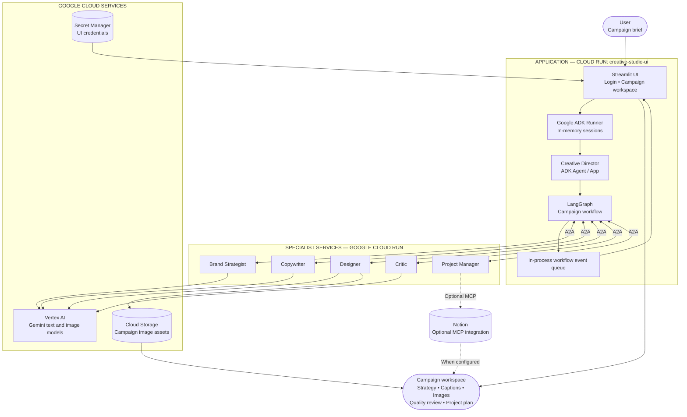
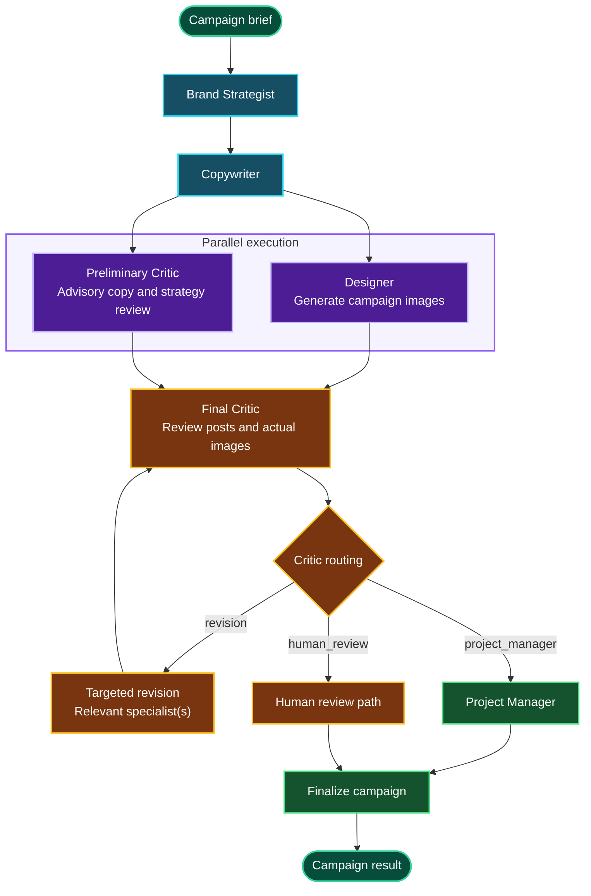

# AI Creative Studio

AI Creative Studio is a multimodal, multi-agent campaign creation application built with **Streamlit, Google Agent Development Kit (ADK), LangGraph, Gemini on Vertex AI, and Google Cloud**.

A user submits a campaign brief through the Streamlit interface. The Creative Director coordinates five specialist agents—Brand Strategist, Copywriter, Designer, Critic, and Project Manager—to develop campaign strategy, write social content, generate visuals, review quality, and prepare a project plan.

The current implementation runs the **Streamlit UI and Creative Director in the same application process**. The five specialist agents remain independently deployed Cloud Run services and are called through the Agent2Agent (A2A) protocol.

> **Implementation note:** This README documents the customized application in this repository. The current UI runs the ADK Creative Director locally in the Streamlit process; it does not call a separately hosted Creative Director service as part of the normal request path.

---

## Table of Contents

- [Overview](#overview)
- [The Problem](#the-problem)
- [The Solution](#the-solution)
- [Who It Is For and Use Cases](#who-it-is-for-and-use-cases)
- [Key Features](#key-features)
- [Application Experience](#application-experience)
- [Architecture](#architecture)
- [Tech Stack](#tech-stack)
- [Project Structure](#project-structure)
- [Prerequisites](#prerequisites)
- [Configuration](#configuration)
- [Run Locally](#run-locally)
- [Deploy to Google Cloud](#deploy-to-google-cloud)
- [Using the App](#using-the-app)
- [Agent Responsibilities](#agent-responsibilities)
- [Workflow and Quality Gate](#workflow-and-quality-gate)
- [Storage, Sessions, and State](#storage-sessions-and-state)
- [Security Notes](#security-notes)
- [Troubleshooting](#troubleshooting)
- [Customization](#customization)
- [Original Codelab Reference](#original-codelab-reference)
- [Contributing](#contributing)
- [License](#license)
- [Acknowledgments](#acknowledgments)

---

## Overview

The application is organized into two deployment layers:

1. **Application layer:** A Streamlit application deployed to Cloud Run. It contains the UI, authentication screen, ADK Runner, in-memory ADK sessions, and the Creative Director / LangGraph workflow.
2. **Specialist layer:** Five independent Cloud Run services. The Creative Director calls these services using A2A.

Gemini models are accessed through Vertex AI. The Designer stores generated campaign images in Google Cloud Storage (GCS). The Project Manager can use the Notion MCP integration to create or update project and task information when configured.

### Current Google Cloud environment

| Setting | Current configuration |
|---|---|
| Google Cloud project | `ai-creative-studio-capstone` |
| Cloud Run region | `us-central1` |
| Streamlit service | `creative-studio-ui` |
| Streamlit service URL | `https://creative-studio-ui-j64xtdfodq-uc.a.run.app` |
| Text model | `gemini-3-flash-preview` |
| Image model | `gemini-3.1-flash-image` |
| Image storage | Google Cloud Storage |
| Application secrets | Google Cloud Secret Manager |

The five specialist Cloud Run service URLs are configured through environment variables.

---

## The Problem

Producing a campaign requires several different skills: research, positioning, copywriting, visual design, quality review, and project planning.

Common challenges include:

- Sequential handoffs between different contributors.
- Manual revisions and feedback routing.
- Scattered campaign context and deliverables.
- Inconsistent quality checks.
- Disconnected captions, images, feedback, and project plans.

AI Creative Studio models this process as a coordinated workflow of specialist agents.

---

## The Solution

A user submits one campaign brief through the Streamlit UI. The Creative Director uses ADK and LangGraph to coordinate the work:

1. Brand Strategist researches the audience, market, competitors, and positioning.
2. Copywriter creates three Instagram caption variations.
3. Designer generates three corresponding visual concepts and image assets.
4. Preliminary Critic reviews strategy and captions while the Designer generates images.
5. Final Critic reviews the complete campaign, including the actual image assets.
6. If revisions are needed, feedback is routed to the relevant specialist.
7. Project Manager prepares the campaign project plan and can integrate with Notion.
8. The workflow finalizes the result and the Streamlit UI presents the deliverables.

---

## Who It Is For and Use Cases

### Marketing and creative teams

Generate campaign strategy, social captions, visual assets, quality feedback, and an actionable project plan.

### Engineers learning multi-agent systems

Explore ADK agents, LangGraph orchestration, A2A communication, Vertex AI model calls, and Cloud Run deployments.

### Teams prototyping agent-based workflows

Use the application as a reference for coordinating independent services with a central workflow, parallel execution, review gates, and targeted revisions.

---

## Key Features

### Campaign creation

- One campaign brief starts the end-to-end workflow.
- Brand and audience strategy is generated before copywriting.
- Three Instagram caption variations are produced.
- Three corresponding campaign image assets are requested from the Designer.
- A project plan is prepared after the quality gate.

### Multi-agent orchestration

- Google ADK provides the Creative Director agent and tool execution.
- LangGraph defines the workflow graph and stage dependencies.
- Five specialist agents run as independent A2A services on Cloud Run.
- Designer and Preliminary Critic run in parallel after Copywriter completes.

### Quality review and revision

- Preliminary Critic feedback is advisory.
- Final Critic performs the campaign quality gate.
- Critic results are parsed into structured status, score, issues, and revision targets.
- Revision work is routed to the specialist identified by the Critic.
- The revised campaign is reviewed again.

### Streamlit user interface

- Login screen backed by credentials injected from Secret Manager.
- Campaign workspace with a persistent card for each deliverable.
- Live stage updates as workflow nodes complete.
- Image previews loaded from GCS.
- Project plan display, including Notion project ID when returned.
- Sidebar navigation and campaign conversation controls.

### Cloud integration

- Gemini model inference through Vertex AI.
- GCS storage for generated campaign images.
- Optional Notion integration through MCP.
- Cloud Run deployment for the Streamlit application and each specialist service.

---

## Application Experience

The Streamlit application provides the user-facing experience:

- **Sign in:** The app checks the configured username and password.
- **Campaign brief:** The user describes the brand, audience, objective, platform, and creative direction.
- **Campaign workspace:** Completed deliverables appear in their own persistent cards.
- **Visual previews:** Generated campaign images are loaded from GCS and shown in the Designer card.
- **Quality review:** The final Critic card shows the decision, score when available, and concise feedback.
- **Project plan:** The Project Manager card displays the plan and task details, plus Notion project information when available.

### Live application

[Open AI Creative Studio](https://creative-studio-ui-j64xtdfodq-uc.a.run.app)

---

## Architecture

### 1. Deployed System Architecture

The Streamlit UI and Creative Director run in the same Cloud Run application container. The UI creates ADK sessions and invokes the local ADK Runner. The Creative Director executes the LangGraph workflow, which calls the five specialist Cloud Run services over A2A.



**Important runtime distinction:** The current Streamlit app imports the Creative Director locally and creates an ADK Runner with an `InMemorySessionService`. The specialist agents are the remote services.

### 2. Campaign Workflow

Brand strategy and copywriting run sequentially. After copywriting, Designer and Preliminary Critic run in parallel. Both must finish before Final Critic begins.



### Workflow nodes

| Node | Responsibility |
|---|---|
| `brand_strategist` | Audience, competitor, trend, and brand-positioning research |
| `copywriter` | Creates three campaign captions |
| `designer` | Creates visual concepts and image assets |
| `preliminary_critic` | Reviews strategy and captions; advisory only |
| `final_critic` | Reviews the complete campaign and determines approval or next action |
| `revision` | Routes targeted feedback to relevant specialist(s) |
| `project_manager` | Produces project plan and optional Notion updates |
| `human_review` | Handles cases requiring human review |
| `finalize` | Assembles the final campaign result |

### 3. Live UI Updates

The Streamlit UI and Creative Director share an in-process event bridge:

1. Streamlit registers a Python queue for the campaign.
2. The UI runs the ADK request in a worker thread.
3. LangGraph publishes completed node events to the registered queue.
4. The UI updates the existing deliverable card instead of appending duplicate cards.
5. Queue registration is removed when the campaign request finishes.

The user-facing cards are:

| Card | Displayed information |
|---|---|
| Brand Strategy | Compact audience and positioning snapshot |
| Social Posts | Full caption deliverables |
| Campaign Visuals | Visual direction and generated image previews |
| Final Quality Review | Approval status, score when available, and key feedback |
| Project Plan | Project overview and task details |

Preliminary Critic notes and internal revision details are retained for workflow use rather than displayed as separate deliverable cards.

**Why the event queue is local:** The queue is process-local. The Streamlit UI and Creative Director must run in the same application process for these live updates to work.

### 4. Runtime and Integrations

| Component | Runtime / technology | Responsibility |
|---|---|---|
| Streamlit UI | Cloud Run | Login, campaign input, live cards, image previews, and project-plan display |
| ADK Runner | In the Streamlit process | Runs the Creative Director and manages ADK execution |
| ADK session service | `InMemorySessionService` | Holds user sessions in process memory |
| Creative Director | Google ADK | Coordinates the campaign workflow |
| Workflow engine | LangGraph | Manages dependencies, parallel nodes, review routing, and revisions |
| Brand Strategist | Cloud Run + A2A | Research and brand strategy |
| Copywriter | Cloud Run + A2A | Campaign copy |
| Designer | Cloud Run + A2A | Image concepts and generation |
| Critic | Cloud Run + A2A | Preliminary and final reviews |
| Project Manager | Cloud Run + A2A | Project plan and optional Notion integration |
| Gemini | Vertex AI | Text and image model inference |
| Google Cloud Storage | GCP object storage | Stores generated campaign images |
| Secret Manager | GCP secret storage | Supplies UI login credentials |
| Notion | Optional MCP integration | Project and task tracking |

---

## Tech Stack

| Layer | Technology | Usage |
|---|---|---|
| User interface | Streamlit | Web application and campaign workspace |
| Agent framework | Google ADK | Creative Director, Runner, sessions, and tools |
| Workflow orchestration | LangGraph | Workflow, parallel nodes, conditional routing, and revision loop |
| Agent communication | A2A | Communication with independent specialist services |
| Text and image models | Gemini on Vertex AI | Text generation, image generation, and image review |
| Image storage | Google Cloud Storage | Generated campaign images |
| Project management | Notion MCP integration | Optional project and task synchronization |
| Application runtime | Google Cloud Run | Streamlit UI and Creative Director |
| Specialist runtime | Google Cloud Run | Five independent specialist agents |
| Secrets | Google Cloud Secret Manager | UI credentials |
| Python environment | Python 3.12 / `uv` | Dependencies and runtime |
| Containerization | Docker | Packages application |
| Deployment | Google Cloud CLI | Cloud Run deployment |

---

## Project Structure

The customized application uses `workshop/starter/` as its working root.

```text
Multi-Agent-Creative-Studio/
├── README.md
├── LICENSE
├── docs/
└── workshop/
    ├── README.md
    ├── diagrams/
    └── starter/
        ├── .env
        ├── .env.example
        ├── .dockerignore
        ├── Dockerfile
        ├── pyproject.toml
        ├── uv.lock
        ├── deploy_ui_updated.sh
        ├── ui/
        │   └── app.py
        ├── agents/
        │   ├── creative_director/
        │   │   ├── __init__.py
        │   │   ├── agent.py
        │   │   ├── display_image_tool.py
        │   │   ├── get_image_links_tool.py
        │   │   └── retry.py
        │   ├── brand_strategist/
        │   ├── copywriter/
        │   ├── designer/
        │   ├── critic/
        │   └── project_manager/
        └── deploy/
```

The UI Docker build uses the project-root Dockerfile and dependency lockfile. The Dockerfile copies both `ui/` and `agents/` into the image so Streamlit can import the local Creative Director.

---

## Prerequisites

- Python 3.12.
- `uv` for dependency management.
- Docker for local container testing.
- Google Cloud CLI (`gcloud`).
- Access to the Google Cloud project `ai-creative-studio-capstone`.
- Billing enabled for the Google Cloud project.
- Required Google Cloud APIs enabled, including Vertex AI, Cloud Run, Cloud Storage, Artifact Registry, and Secret Manager.
- A configured GCS bucket for generated images.
- Five deployed specialist Cloud Run services with working A2A endpoints.
- Notion integration configuration only if Notion project tracking is required.

The Cloud Run UI runtime service account needs permission to call Vertex AI, read generated images from the configured GCS bucket, and access UI credentials in Secret Manager.

---

## Configuration

The application reads local configuration from `workshop/starter/.env`.

Do not commit `.env` or paste secret values into source control.

### Application and model settings

| Variable | Purpose | Example / current value |
|---|---|---|
| `GOOGLE_CLOUD_PROJECT` | Google Cloud project ID | `ai-creative-studio-capstone` |
| `GOOGLE_CLOUD_LOCATION` | Vertex AI model location | `global` |
| `GOOGLE_GENAI_USE_VERTEXAI` | Route Gemini calls through Vertex AI | `true` |
| `GEMINI_MODEL` | Text model | `gemini-3-flash-preview` |
| `GEMINI_IMAGE_MODEL` | Image model | `gemini-3.1-flash-image` |
| `GCS_IMAGES_BUCKET` | Campaign image bucket | Your configured bucket |
| `ADK_USER_ID` | ADK user identifier | `creative-studio-user` |

### Specialist A2A endpoints

Set each variable to the actual deployed Cloud Run URL for its specialist:

```env
STRATEGIST_AGENT_URL=https://<brand-strategist-cloud-run-url>
COPYWRITER_AGENT_URL=https://<copywriter-cloud-run-url>
DESIGNER_AGENT_URL=https://<designer-cloud-run-url>
CRITIC_AGENT_URL=https://<critic-cloud-run-url>
PM_AGENT_URL=https://<project-manager-cloud-run-url>
```

### Streamlit authentication

The current UI reads:

```env
APP_USERNAME=<your-ui-username>
APP_PASSWORD=<your-ui-password>
ADK_USER_ID=creative-studio-user
```

For Cloud Run, the deployment script maps Secret Manager secrets to `APP_USERNAME` and `APP_PASSWORD`.

Secret names used by the deployment script:

- `creative-studio-username`
- `creative-studio-password`

Do not put actual credentials in this README.

---

## Run Locally

Run these commands from `workshop/starter/`.

```bash
# Create a virtual environment
uv venv

# Activate the environment
source .venv/bin/activate

# Install dependencies
uv sync --frozen

# Create your local environment file if needed
cp .env.example .env

# Edit .env with your project, bucket, model, and specialist URLs.

# Authenticate for Google Cloud services
gcloud auth application-default login

# Start Streamlit
streamlit run ui/app.py
```

Open the local Streamlit URL printed in the terminal, typically:

```text
http://localhost:8501
```

The Streamlit app starts the ADK Runner and Creative Director in the same process. The five specialist services must already be deployed and reachable unless you are separately running them locally.

---

## Deploy to Google Cloud

### Streamlit UI deployment

The customized UI deployment script is:

```bash
bash deploy_ui_updated.sh
```

Run it from `workshop/starter/`.

The script:

1. Checks the Dockerfile, `.dockerignore`, `pyproject.toml`, `uv.lock`, `.env`, `ui/app.py`, and Creative Director folder.
2. Checks the dependency lockfile with `uv lock --check`.
3. Verifies Google Cloud CLI authentication and selects `ai-creative-studio-capstone`.
4. Checks that the two UI login secrets exist in Secret Manager.
5. Creates or reuses the `creative-studio-ui` runtime service account.
6. Grants Secret Manager access to the username and password secrets.
7. Grants the service account Vertex AI User access.
8. Deploys the `creative-studio-ui` Cloud Run service in `us-central1`.
9. Maps Secret Manager values to `APP_USERNAME` and `APP_PASSWORD`.

The deployment script uses the project-root Dockerfile and includes both `ui/` and `agents/` in the application image.

> **Important:** The saved deployment script also requires `AGENT_ENGINE_RESOURCE_NAME` and sets `AGENT_ENGINE_LOCATION`. This appears to be a leftover from the earlier Agent Engine deployment path. The current Streamlit implementation runs the Creative Director locally. Verify and remove the obsolete requirement from the deployment script if it is no longer used by your current code.

### Specialist deployments

The five specialist agents remain separate Cloud Run services.

Deploy or update the specialists independently. After deployment, confirm their service URLs and set the corresponding `*_AGENT_URL` values in the application `.env` before rebuilding the Streamlit UI.

### Runtime permissions

The UI runtime service account needs:

- `roles/secretmanager.secretAccessor` on the two UI credential secrets.
- `roles/aiplatform.user` on the project to invoke Gemini through Vertex AI.
- Permission to read generated objects from the campaign image bucket, such as `roles/storage.objectViewer`.

The specialist services need permissions for their own responsibilities, such as Vertex AI model access, GCS image writes/reads, and Notion credentials where applicable.

---

## Using the App

1. Open the deployed Streamlit application.
2. Sign in using the username and password configured in Secret Manager.
3. Start a campaign and enter a clear brief.
4. Include the brand/product, target audience, campaign goal, platform, tone, and visual constraints.
5. Submit the brief.
6. Watch the campaign workspace cards populate as the workflow progresses.
7. Review the strategy, captions, generated images, final quality review, and project plan.
8. If the Critic requests revisions, the relevant deliverable card is updated when the revised result is returned.

### Example campaign brief

```text
Create an Instagram campaign for a premium reusable water bottle.
Target health-conscious millennials. Emphasize hydration tracking,
everyday convenience, and a clean modern design. Use an optimistic,
educational tone and create three distinct post concepts.
```

---

## Agent Responsibilities

### Brand Strategist

- Researches the target audience and market context.
- Identifies competitor positioning, trends, and customer pain points.
- Recommends campaign positioning and strategic direction.

### Copywriter

- Uses the campaign brief and Brand Strategist output.
- Produces three Instagram caption variations.
- Uses distinct tonal registers, hooks, calls to action, and relevant hashtags.

### Designer

- Uses the brief, strategy, and captions to create matching visual concepts.
- Generates campaign images using the configured Gemini image model.
- Saves generated images to the configured GCS bucket.
- Returns image references for review and display.

### Critic

- Runs a preliminary advisory review of strategy and captions in parallel with image generation.
- Runs the final review after the Designer and Preliminary Critic complete.
- Reviews posts and actual image assets.
- Returns structured review sections and an approval/revision recommendation.

### Project Manager

- Creates the campaign timeline, milestones, and tasks.
- Can use the Notion MCP integration when credentials and database configuration are supplied.
- Returns a project plan according to the specialist implementation.

---

## Workflow and Quality Gate

The Critic is a quality gate, not just a summarizer.

- Posts and visuals are evaluated separately.
- The final review expects Posts Review, Visuals Review, and Overall Assessment.
- Scores from 7–10 are treated as potentially approvable; scores from 1–6 require revision, consistent with the Critic rubric.
- A campaign missing the expected three image URIs is not automatically approved.
- If only copy needs revision, the workflow can target Copywriter.
- If only visuals need revision, the workflow can target Designer.
- If both need revision, the relevant specialists can be called for targeted changes.
- If the Critic output is incomplete or contradictory, the workflow can route to human review rather than guessing.

The Preliminary Critic is advisory and does not approve the complete campaign because the images may still be in progress.

---

## Storage, Sessions, and State

### Generated images

Generated campaign images are stored in Google Cloud Storage. The Streamlit UI reads GCS image references and downloads image bytes through the Cloud Storage client to display previews.

### Workflow event bridge

The Creative Director publishes workflow-node completion events to a Python queue registered by the Streamlit UI. This allows the UI to update deliverable cards while the workflow is running.

The queue is process-local and is not a cross-service message broker.

### ADK sessions and LangGraph checkpoints

The current application uses `InMemorySessionService` for ADK sessions and an in-memory LangGraph checkpointer.

These are not durable stores. Session and checkpoint state can be lost when a Cloud Run instance restarts or a request is routed to another instance.

### Conversation history

The Streamlit session state holds the active UI state in memory. It should not be treated as durable campaign history or a long-term database.

---

## Security Notes

- Never commit `.env`, passwords, API tokens, or service-account keys.
- Store the UI username and password in Google Cloud Secret Manager.
- Grant the Cloud Run runtime service account only the permissions it needs.
- Use Application Default Credentials for local development rather than downloading service-account keys.
- Keep specialist endpoint configuration in environment variables.
- Review whether unauthenticated Cloud Run invocation is appropriate for your environment. The UI's login screen is application-level authentication and is not a substitute for network/IAM access controls.
- Avoid putting personal or confidential information into campaign briefs unless the application is approved for that data.
- The current in-memory session and event architecture is intended for a lightweight application deployment. Production use requiring durable state, multi-instance coordination, or audit history should add appropriate persistent storage and access controls.

---

## Troubleshooting

| Symptom | Checks |
|---|---|
| Login page says credentials are not configured | Confirm `APP_USERNAME` and `APP_PASSWORD` are mapped from the Secret Manager secrets. |
| Streamlit app fails during startup | Check Cloud Run logs, Python dependencies, Docker build context, and that the Dockerfile copies both `ui/` and `agents/`. |
| `ModuleNotFoundError` for `creative_director` | Confirm `agents/creative_director/` is copied into the container and Dockerfile sets `PYTHONPATH=/app/agents`. |
| Vertex AI permission error | Grant the UI runtime service account `roles/aiplatform.user` and verify project and location. |
| Gemini model not found or unavailable | Confirm `GEMINI_MODEL`, `GEMINI_IMAGE_MODEL`, and model availability in the configured location. |
| Specialist URL missing | Check all five `*_AGENT_URL` environment variables. |
| A2A request times out | Confirm the specialist Cloud Run service is deployed, reachable, and healthy. Inspect its Cloud Run logs and A2A timeout settings. |
| Image generation succeeds but preview fails | Confirm the GCS URI is correct and the UI runtime service account can read the object. |
| Notion project/task sync fails | Check the Notion MCP server configuration, token, database IDs, and integration permissions. |
| Live UI cards do not update | Confirm the UI and Creative Director run in the same process and the workflow event queue is registered. |
| Workflow state disappears after restart | This is expected with the current in-memory session and checkpoint configuration. Use persistent storage if durable state is required. |

---

## Customization

| Goal | Where to look |
|---|---|
| Change Streamlit branding, layout, or card presentation | `ui/app.py` |
| Change login behavior | `ui/app.py` and `APP_USERNAME` / `APP_PASSWORD` configuration |
| Change campaign workflow or routing | `agents/creative_director/agent.py` |
| Change order or dependencies of workflow nodes | `build_campaign_graph()` |
| Change Critic approval/revision behavior | Critic prompt, review parser, and `route_after_critic` |
| Change live deliverable card updates | Workflow event publishing and queue consumption |
| Change text model | `GEMINI_MODEL` |
| Change image model | `GEMINI_IMAGE_MODEL` |
| Change image storage | `GCS_IMAGES_BUCKET` and Designer implementation |
| Change specialist service endpoints | The five `*_AGENT_URL` variables |
| Change project tracking | Project Manager agent and Notion MCP configuration |
| Change UI container packaging | `Dockerfile`, `.dockerignore`, `pyproject.toml`, and `uv.lock` |
| Change UI deployment | `deploy_ui_updated.sh` |

---

## Original Codelab Reference

This repository originated from the AI Creative Studio codelab:

[Published codelab](https://ani-in.github.io/Multi-Agent-Creative-Studio/)

The original codelab and workshop material are retained in `docs/` and `workshop/`. They explain the concepts behind ADK agents, A2A, Skills, MCP, specialist services, and Google Cloud deployment.

The original codelab's deployment walkthrough describes a different topology in which the Creative Director is deployed to Vertex AI Agent Engine. The customized application documented here instead runs the Creative Director inside the Streamlit Cloud Run process.

Use the original workshop instructions as learning/reference material and the current `ui/`, `agents/creative_director/`, root Dockerfile, and UI deployment configuration for the customized application.

---

## Contributing

Contributions that improve the application, agent behavior, UI experience, deployment reliability, or documentation are welcome.

Before submitting a change:

1. Keep secrets and local configuration out of source control.
2. Test the affected agent or UI flow locally.
3. Confirm workflow changes preserve the intended graph dependencies and quality gate.
4. Update this README when runtime, configuration, or deployment behavior changes.

---

## License

This repository retains the license and attribution requirements of the original codelab. See the repository's `LICENSE` and related notice files for the applicable terms. Preserve the original copyright and attribution notices when modifying or redistributing the project.

---

## Acknowledgments

- Authors and maintainers of the original AI Creative Studio codelab.
- Google ADK and LangGraph for agent and workflow orchestration.
- A2A protocol for agent-to-agent communication.
- Gemini models on Vertex AI for text and image capabilities.
- Google Cloud Run, Cloud Storage, Secret Manager, and Vertex AI.
- Model Context Protocol and Notion MCP integration for optional project tracking.
- Streamlit for the application interface.
